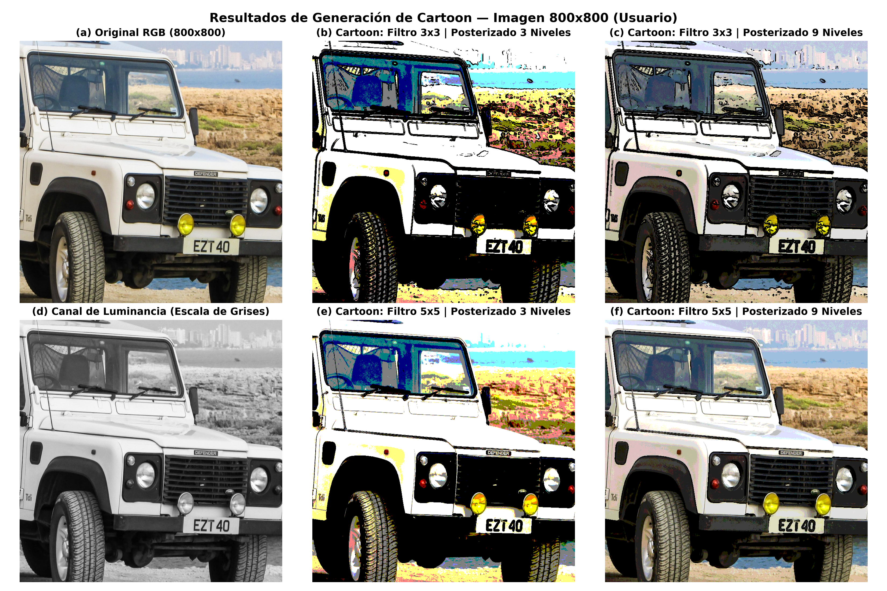
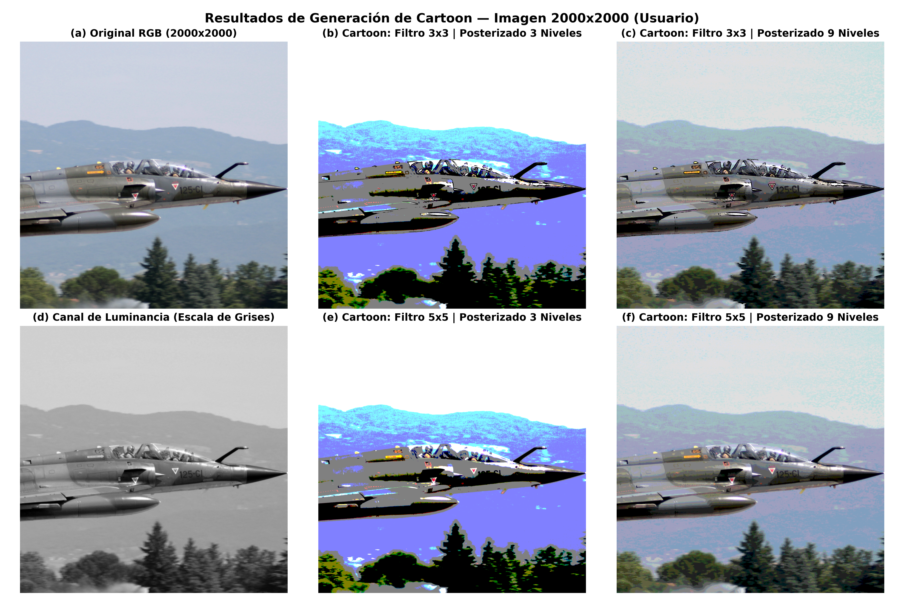
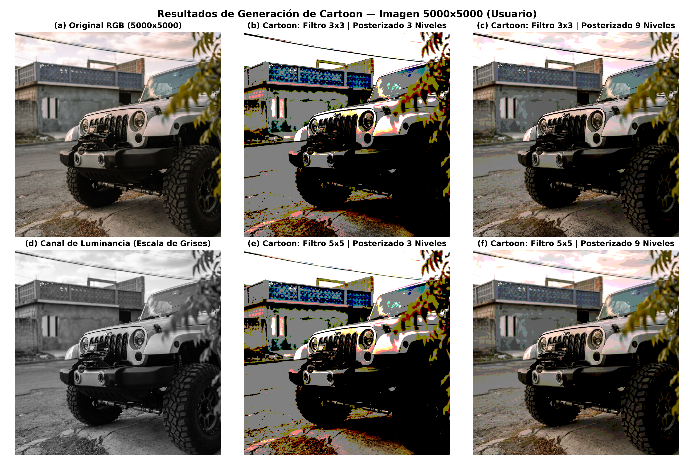

# Trabajo Práctico Final Integrador (TPFI) — Computación Avanzada 2026
**Universidad Autónoma de Entre Ríos (UADER) — Facultad de Ciencia y Tecnología**  
**Tema:** Generación de Cartoons a partir de Imágenes (Secuencial, MPI, OpenMP e Híbrido)

---

## 📌 ¿De qué trata el proyecto?

Este proyecto transforma una imagen original en una imagen tipo **Cartoon** (dibujo animado) combinando dos pasos:
1. **Detección de bordes:** Convierte a escala de grises, elimina el ruido con un **filtro de borroneo ($3\times 3$ o $5\times 5$)**, resalta los bordes con **Sobel** y aplica un **umbralado** para quedarse con los contornos negros.
2. **Posterizado:** Reduce los colores de cada canal (R, G, B) a un rango pequeño de **3 valores** o **9 valores**.
3. **Unión final:** Dibuja los bordes negros sobre la imagen posterizada.

Se implementaron las **4 versiones** pedidas por la cátedra:
- **`src/secuencial.c`**: Versión secuencial (un solo hilo).
- **`src/openmp.c`**: Versión paralela en memoria compartida usando hilos (**OpenMP**).
- **`src/mpi.c`**: Versión paralela en memoria distribuida usando pasaje de mensajes (**MPI**).
- **`src/mpi_openmp.c`**: Versión paralela **Híbrida** (**MPI + OpenMP**).

---

## 🖼️ Resultados Visuales Obtenidos

Se probaron las 3 imágenes (**800x800**, **2000x2000** y **5000x5000**) con filtros de **3x3** y **5x5**, y posterizado de **3** y **9** valores.

### Láminas Comparativas Completas (`output/plots/`)
Comparación lado a lado de la imagen original, escala de grises y las 4 combinaciones de Cartoon (Filtro $3\times 3$ y $5\times 5$, Posterizado 3 y 9):
- 🖼️ [**Lámina Comparativa 800x800**](file:///c:/Users/Zona/Desktop/TPFI - CA/output/plots/comparativa_800x800.png)
- 🖼️ [**Lámina Comparativa 2000x2000**](file:///c:/Users/Zona/Desktop/TPFI - CA/output/plots/comparativa_2000x2000.png)
- 🖼️ [**Lámina Comparativa 5000x5000**](file:///c:/Users/Zona/Desktop/TPFI - CA/output/plots/comparativa_5000x5000.png)
- 🖼️ [**Etapas del Pipeline Cartoon**](file:///c:/Users/Zona/Desktop/TPFI - CA/output/plots/pipeline_etapas.png)





### Imágenes Cartoon Individuales (`output/resultados_cartoon/`)
| Tamaño | Filtro 3x3 (Poster 3) | Filtro 3x3 (Poster 9) | Filtro 5x5 (Poster 3) | Filtro 5x5 (Poster 9) |
|:---:|:---:|:---:|:---:|:---:|
| **800x800** | [Ver PNG](file:///c:/Users/Zona/Desktop/TPFI - CA/output/resultados_cartoon/cartoon_800x800_filtro3x3_poster3.png) | [Ver PNG](file:///c:/Users/Zona/Desktop/TPFI - CA/output/resultados_cartoon/cartoon_800x800_filtro3x3_poster9.png) | [Ver PNG](file:///c:/Users/Zona/Desktop/TPFI - CA/output/resultados_cartoon/cartoon_800x800_filtro5x5_poster3.png) | [Ver PNG](file:///c:/Users/Zona/Desktop/TPFI - CA/output/resultados_cartoon/cartoon_800x800_filtro5x5_poster9.png) |
| **2000x2000** | [Ver PNG](file:///c:/Users/Zona/Desktop/TPFI - CA/output/resultados_cartoon/cartoon_2000x2000_filtro3x3_poster3.png) | [Ver PNG](file:///c:/Users/Zona/Desktop/TPFI - CA/output/resultados_cartoon/cartoon_2000x2000_filtro3x3_poster9.png) | [Ver PNG](file:///c:/Users/Zona/Desktop/TPFI - CA/output/resultados_cartoon/cartoon_2000x2000_filtro5x5_poster3.png) | [Ver PNG](file:///c:/Users/Zona/Desktop/TPFI - CA/output/resultados_cartoon/cartoon_2000x2000_filtro5x5_poster9.png) |
| **5000x5000** | [Ver PNG](file:///c:/Users/Zona/Desktop/TPFI - CA/output/resultados_cartoon/cartoon_5000x5000_filtro3x3_poster3.png) | [Ver PNG](file:///c:/Users/Zona/Desktop/TPFI - CA/output/resultados_cartoon/cartoon_5000x5000_filtro3x3_poster9.png) | [Ver PNG](file:///c:/Users/Zona/Desktop/TPFI - CA/output/resultados_cartoon/cartoon_5000x5000_filtro5x5_poster3.png) | [Ver PNG](file:///c:/Users/Zona/Desktop/TPFI - CA/output/resultados_cartoon/cartoon_5000x5000_filtro5x5_poster9.png) |

---

## 📊 Resumen de Tiempos, Speedup y Eficiencia

* **Speedup ($S = T_s / T_p$):** Cuántas veces más rápido corre la versión paralela frente a la secuencial.
* **Eficiencia ($E = S / p$):** Porcentaje de aprovechamiento de los núcleos ($p$).

### Tabla Resumen (Filtro 3x3 — Posterizado 9 valores)

| Configuración | Cores ($p$) | 800x800 (Tiempo / Speedup / Ef.) | 2000x2000 (Tiempo / Speedup / Ef.) | 5000x5000 (Tiempo / Speedup / Ef.) |
|:---|:---:|:---:|:---:|:---:|
| **Secuencial** | 1 | 0.0320 s / 1.00x / 100% | 0.1413 s / 1.00x / 100% | 1.2495 s / 1.00x / 100% |
| **OpenMP (2T)** | 2 | 0.0186 s / 1.72x / 85.9% | 0.0627 s / 2.26x / 112.8% | 0.5072 s / 2.46x / 123.2% |
| **OpenMP (4T)** | 4 | 0.0337 s / 0.95x / 23.7% | 0.0430 s / **3.29x** / 82.2% | 0.3108 s / **4.02x** / 100.5% |
| **OpenMP (8T)** | 8 | 0.0249 s / 1.28x / 16.0% | 0.0383 s / **3.69x** / 46.2% | 0.2418 s / **5.17x** / 64.6% |
| **MPI (2P)** | 2 | 0.0161 s / 1.98x / 98.9% | 0.0941 s / 1.50x / 75.1% | 0.6582 s / 1.90x / 94.9% |
| **MPI (4P)** | 4 | 0.0120 s / 2.67x / 66.8% | 0.0564 s / 2.51x / 62.6% | 0.3463 s / **3.61x** / 90.2% |
| **Híbrido (2Px2T)** | 4 | 0.0100 s / **3.19x** / 79.8% | 0.0494 s / 2.86x / 71.6% | 0.3782 s / 3.30x / 82.6% |
| **Híbrido (4Px2T)** | 8 | 0.0160 s / 2.00x / 25.0% | 0.0576 s / 2.45x / 30.7% | 0.3606 s / **3.47x** / 43.3% |

*(Todos los datos completos con filtro 3x3 y 5x5, y posterizado 3 y 9 están en [`output/benchmark_results.csv`](file:///c:/Users/Zona/Desktop/TPFI - CA/output/benchmark_results.csv) y [`output/benchmark_results.json`](file:///c:/Users/Zona/Desktop/TPFI - CA/output/benchmark_results.json)).*

---

## 📊 Archivos de Datos de Desempeño

- 📊 [**Datos completos en CSV (`output/benchmark_results.csv`)**](file:///c:/Users/Zona/Desktop/TPFI - CA/output/benchmark_results.csv)
- 📋 [**Datos completos en JSON (`output/benchmark_results.json`)**](file:///c:/Users/Zona/Desktop/TPFI - CA/output/benchmark_results.json)

---

## 🚀 Cómo Compilar y Ejecutar

```bash
# Compilar las 4 versiones
make clean && make

# 1. Ejecutar Secuencial (parámetros: entrada salida filtro poster umbral)
./bin/secuencial data/test_2000.ppm output/out_sec.ppm 3 9 70

# 2. Ejecutar OpenMP (con 4 threads)
./bin/openmp data/test_2000.ppm output/out_omp.ppm 4 3 9 70

# 3. Ejecutar MPI (con 4 procesos)
mpirun -np 4 ./bin/mpi data/test_2000.ppm output/out_mpi.ppm 3 9 70

# 4. Ejecutar Híbrido (2 procesos MPI x 2 threads OpenMP = 4 cores)
mpirun -np 2 ./bin/mpi_openmp data/test_2000.ppm output/out_hyb.ppm 2 3 9 70
```
